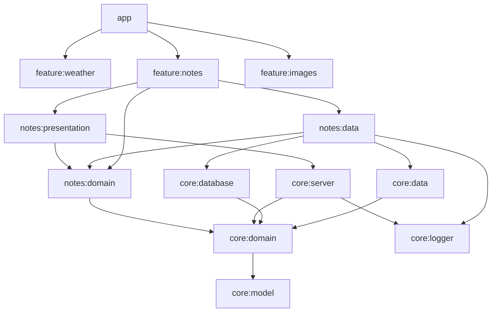

# Ktor Server: Large-Scale Architecture Template

A reference multi-module Kotlin backend built on Ktor and clean architecture, meant to be cloned
as the starting point for new services. It ships three end-to-end features that each show a common
backend concern:

| Feature   | What it demonstrates                                                                        |
|-----------|---------------------------------------------------------------------------------------------|
| `weather` | Calling an external API (Open-Meteo) with a database cache, TTL and stale-on-error fallback |
| `notes`   | Local CRUD with pagination and domain validation                                            |
| `images`  | Multipart upload with size/type limits, pluggable file storage, download and delete         |

## Stack

| Concern         | Choice                                                                    |
|-----------------|---------------------------------------------------------------------------|
| Language / JVM  | Kotlin 2.4.21, JVM toolchain 21                                           |
| Build           | Gradle 9.8.2, version catalog, `build-logic` convention plugins          |
| Server          | Ktor 3.6.1 (Netty), kotlinx.serialization                                 |
| DI              | Koin 4.2.2 (isolated context per application)                             |
| Persistence     | Exposed 1.6.0, Flyway 13.12.0, HikariCP; H2 locally, PostgreSQL in Docker |
| HTTP client     | Ktor client (CIO)                                                         |
| API docs        | OpenAPI generated from the routing tree, served with Swagger UI          |
| Logging         | SLF4J + Logback, plain text or JSON (logstash encoder)                    |
| Quality         | detekt 1.23.8, ktlint 1.8.0 through kotlinter 5.7.0                       |
| Tests           | JUnit 6, kotlin.test, kotlinx-coroutines-test, Ktor `testApplication`     |

All versions live in [`gradle/libs.versions.toml`](gradle/libs.versions.toml); build files never
hardcode a version.

## Module graph



`weather` and `images` follow the same shape as `notes`; `weather:data` also uses `core:network`
and `images:data` uses `core:storage`.

| Module            | Responsibility                                                                                   |
|-------------------|--------------------------------------------------------------------------------------------------|
| `app`             | Entry point: HOCON config, Koin wiring, Ktor plugins, health check, Swagger UI                   |
| `core:model`      | Plain shared models: `Page`, `PageRequest`, `FieldViolation`                                     |
| `core:domain`     | Framework-free domain kernel: `Outcome`, `DomainError`, validation DSL, `DispatcherProvider`     |
| `core:logger`     | Backend-agnostic structured `Logger` API with an SLF4J implementation                            |
| `core:data`       | Data-layer helpers: `outcomeCatching` (exceptions to typed errors), default dispatchers         |
| `core:database`   | `AppDatabase` (Hikari + Exposed), Flyway migrations in `src/main/resources/db/migration`         |
| `core:network`    | Ktor `HttpClient` factory and `safeRequest` (HTTP failures to `NetworkError`)                    |
| `core:storage`    | `FileStorage` abstraction and the local-disk `LocalFileStorage`                                  |
| `core:server`     | Shared HTTP layer: problem+json errors, StatusPages, paging/UUID parameters, `ServerFeature`     |
| `core:testing`    | Test fixtures: in-memory database, `MutableClock`, recording logger, `testFeature` harness       |
| `feature:<name>`  | Wiring module: the feature's Koin module and route registration (`ServerFeature`)                |
| `…:domain`        | Entities, repository ports, use cases, typed errors. Pure Kotlin. Fakes in `testFixtures`        |
| `…:data`          | Repository implementations (Exposed, HTTP, file storage); internal, exposed through factories   |
| `…:presentation`  | Routes, DTOs, error-to-HTTP mapping, OpenAPI descriptions                                        |
| `e2e`             | Black-box end-to-end suite: HTTP client only, no dependency on any server module                 |

### Rules the structure enforces

- **Dependencies point inward.** `presentation` and `data` depend on `domain`, never on each other.
  Only the feature's wiring module sees all three, and only `app` sees the wiring modules.
- **`core:domain` and every `feature:*:domain` are framework-free.** No Ktor, Koin, Exposed or SLF4J.
- **Typed errors, not exceptions.** Fallible operations return `Outcome<T, E : DomainError>`.
  Infrastructure exceptions are turned into typed errors at the data-layer boundary
  (`outcomeCatching`, `safeRequest`), and presentation maps each error to an RFC 9457 problem.
- **Explicit API mode** on all `core:*` modules; implementation classes elsewhere are `internal`.

## Build conventions (`build-logic`)

| Plugin id                 | Applied to               | What it does                                                         |
|---------------------------|--------------------------|----------------------------------------------------------------------|
| `template.kotlin.jvm`     | every module             | Kotlin/JVM, toolchain 21, warnings as errors, detekt, ktlint, tests |
| `template.kotlin.library` | `core:*`                 | `template.kotlin.jvm` plus explicit API mode                         |
| `template.ktor.feature`   | feature wiring and presentation modules | Ktor server, serialization, Koin, `core:server`         |
| `template.testing`        | (via `kotlin.jvm`)       | JUnit Platform, kotlin.test, coroutines-test, `core:testing`         |
| `template.detekt`         | (via `kotlin.jvm`)       | detekt on top of the default rules, `config/detekt/detekt.yml`       |
| `template.ktlint`         | (via `kotlin.jvm`)       | kotlinter; `ktlintCheck` / `ktlintFormat` aliases                    |
| `template.e2e`            | `e2e`                    | `e2eTest` source set and task, server lifecycle for the suite        |
| `template.git.hooks`      | root project             | `installGitHooks` task                                               |

ktlint uses the `ktlint_official` style, configured in [`.editorconfig`](.editorconfig).

## Running

Requires JDK 21 (Gradle provisions the toolchain from a local JDK 21 installation).

### Locally (H2)

```bash
./gradlew :app:run
```

The server listens on `http://localhost:8080`, stores its H2 database and uploads under `./data/`
and applies Flyway migrations on startup. Swagger UI: <http://localhost:8080/swagger>.

To run the packaged jar instead:

```bash
./gradlew :app:buildFatJar
java -jar app/build/libs/app.jar
```

### With PostgreSQL (docker-compose)

```bash
docker compose up --build
```

This starts PostgreSQL 18 and the API (JSON logs) on port 8080. Uploads and the database are kept
in named volumes; `docker compose down -v` removes them.

### Configuration

[`app/src/main/resources/application.conf`](app/src/main/resources/application.conf) holds the
defaults; each value can be overridden with an environment variable:

| Variable                      | Default                         | Purpose                               |
|-------------------------------|---------------------------------|---------------------------------------|
| `PORT`                        | `8080`                          | HTTP port                             |
| `DATABASE_URL`                | H2 file database in `./data`    | JDBC URL (`jdbc:postgresql://…`)      |
| `DATABASE_USER` / `DATABASE_PASSWORD` | `sa` / empty            | Database credentials                  |
| `DATABASE_POOL_SIZE`          | `10`                            | Hikari maximum pool size              |
| `STORAGE_ROOT`                | `./data/uploads`                | Directory for uploaded files          |
| `HTTP_CLIENT_REQUEST_TIMEOUT` | `10s`                           | Outgoing request timeout              |
| `HTTP_CLIENT_CONNECT_TIMEOUT` | `5s`                            | Outgoing connect timeout              |
| `WEATHER_BASE_URL`            | `https://api.open-meteo.com`    | Weather provider                      |
| `WEATHER_CACHE_TTL`           | `15m`                           | How long a cached reading is fresh    |
| `IMAGES_MAX_SIZE_BYTES`       | `5242880` (5 MiB)               | Upload size limit                     |
| `LOG_FORMAT`                  | `PLAIN`                         | `PLAIN` or `JSON`                     |
| `LOG_LEVEL`                   | `INFO`                          | Root log level                        |

Every request gets a correlation id: a valid `X-Request-Id` header is reused, otherwise one is
generated. It is echoed in the response and attached to every log line of that request
(`call-id`).

## Code quality

```bash
./gradlew check            # tests + detekt + ktlint, must pass with zero issues
./gradlew ktlintFormat     # auto-format
./gradlew installGitHooks  # optional: pre-commit hook running ktlintCheck and detekt
```

The hook script is versioned in [`scripts/git-hooks/pre-commit`](scripts/git-hooks/pre-commit).
detekt's formatting wrapper is deliberately not enabled, since ktlint already covers formatting.
Any `@Suppress` needs a one-line justification comment.

## Testing

| Level        | Where                              | How                                                                    |
|--------------|------------------------------------|------------------------------------------------------------------------|
| Use cases    | `feature:<name>:domain` tests      | Fakes from the module's `testFixtures` (no mocking library)            |
| Data         | `feature:<name>:data` tests        | Real Exposed repositories on in-memory H2; `MockEngine` for HTTP       |
| Routes       | `feature:<name>` tests             | `testFeature(...)`: real wiring, H2, `testApplication`, JSON client    |
| Application  | `app` tests                        | Full `module()`: health, request ids, generated OpenAPI document       |
| End-to-end   | `e2e` (`./gradlew :e2e:e2eTest`)   | Packaged `app.jar` driven over HTTP only, see below                    |

### End-to-end tests

The `e2e` module treats the server as a black box. It has no project dependencies, keeps its own
copy of the JSON contract and talks to the API with a plain Ktor client, so a wire-format change
breaks it the same way it would break a real consumer. Every test creates its own data and makes
no assumption about what is already stored, so the suite can run against any deployment.

```bash
# Builds app.jar, starts it (in-memory H2, fake weather provider, random port), runs the suite, stops it
./gradlew :e2e:e2eTest

# Runs the same suite against a server that is already running, e.g. docker compose
E2E_BASE_URL=http://localhost:8080 ./gradlew :e2e:e2eTest
```

In the managed mode the server is configured only through environment variables, exactly as in
production, and its log is written to `e2e/build/e2e/server.log`. The suite is not part of
`check` (it needs a running server), but its sources are compiled and linted by `check`.

## Continuous integration

[`.github/workflows/ci.yml`](.github/workflows/ci.yml) runs on pushes to `main`, on pull requests
and on demand. There is no deployment step.

| Job      | What it runs                                                                                   |
|----------|------------------------------------------------------------------------------------------------|
| `build`  | `./gradlew build`: compilation, all unit and integration tests, detekt, ktlint                 |
| `e2e`    | `./gradlew :e2e:e2eTest` against the packaged app (H2, fake weather provider)                  |
| `docker` | `docker compose up --build --wait`, then the e2e suite against the container on PostgreSQL     |

The `docker` job calls the real Open-Meteo API for its weather test. Test reports, the server log or
the container logs are attached to failed runs. Code owners are listed in
[`.github/CODEOWNERS`](.github/CODEOWNERS).

## Adding a feature module

Say the feature is called `bookmarks`:

1. **Register the modules.** In `settings.gradle.kts`, add it to the list:
   `include(features("weather", "notes", "images", "bookmarks"))`.
2. **Create the four build files**, copying them from `feature/notes`:
   - `feature/bookmarks/domain/build.gradle.kts`: `template.kotlin.jvm` + `java-test-fixtures`, `api(projects.core.domain)`
   - `feature/bookmarks/data/build.gradle.kts`: `template.kotlin.jvm`; `api` on its `domain` and on every core module its public factories expose (`core:database`, `core:logger`), `implementation` on `core:data`
   - `feature/bookmarks/presentation/build.gradle.kts`: `template.ktor.feature`, `api` on its `domain`
   - `feature/bookmarks/build.gradle.kts`: `template.ktor.feature`, depends on all three layers
3. **Domain** (`com.tlpcraft.ktor.template.feature.bookmarks.domain`): entity, `BookmarkError`
   (`sealed interface : DomainError`), `BookmarkRepository` port, use cases. Put a fake repository in
   `src/testFixtures`.
4. **Schema**: add the next migration, e.g. `core/database/src/main/resources/db/migration/V4__create_bookmarks.sql`.
5. **Data**: an `internal` Exposed table and repository plus a public factory
   (`fun bookmarkRepository(database, loggerFactory): BookmarkRepository`).
6. **Presentation**: DTOs, `BookmarkError.toProblem()`, a `BookmarkRoutes` class and its
   `describe { }` OpenAPI blocks.
7. **Wiring**: `object BookmarksFeature : ServerFeature` with the Koin module and
   `routes(route) = route.get<BookmarkRoutes>().register(route)`. Read its own config section
   (e.g. `bookmarks.*`) inside `koinModule(config)`.
8. **Install it**: add `BookmarksFeature` to `serverFeatures` in
   [`app/.../Application.kt`](app/src/main/kotlin/com/tlpcraft/ktor/template/app/Application.kt) and
   `implementation(projects.feature.bookmarks)` to `app/build.gradle.kts`.
9. **Test it**: use case tests with the fakes, a route test with `testFeature(BookmarksFeature) { client -> … }`,
   then `./gradlew check`.

## API

All feature endpoints live under `/api/v1`. Errors use `application/problem+json`:

```json
{
  "type": "urn:problem-type:validation-failed",
  "title": "Bad Request",
  "status": 400,
  "detail": "One or more fields are invalid.",
  "violations": [{ "field": "title", "message": "must not be blank" }]
}
```

| Status | `type` suffix             | When                                                  |
|--------|---------------------------|-------------------------------------------------------|
| 400    | `validation-failed`       | Invalid fields, query or path parameters              |
| 400    | `bad-request`             | Malformed JSON body                                   |
| 404    | `not-found`               | Unknown id or route                                   |
| 413    | `payload-too-large`       | Upload over the size limit                            |
| 415    | `unsupported-media-type`  | Upload is not a supported image                       |
| 503    | `service-unavailable`     | Database or weather provider unavailable              |
| 500    | `internal-error`          | Bug; details are logged, never returned               |

### Examples

```bash
BASE=http://localhost:8080
```

**Health**

```bash
curl -s $BASE/health
# {"status":"UP","checks":{"database":"UP"}}
```

**OpenAPI document and Swagger UI**

```bash
curl -s $BASE/swagger/openapi.json
open $BASE/swagger   # or xdg-open
```

**Weather**

```bash
curl -s "$BASE/api/v1/weather/current?latitude=46.77&longitude=23.62"
# {"latitude":46.77,"longitude":23.62,"temperatureCelsius":7.1,"windSpeedKmh":9.6,"condition":"RAIN",
#  "weatherCode":61,"observedAt":"…","fetchedAt":"…","freshness":"LIVE"}
# Repeating the call within the TTL returns "freshness":"CACHED".

curl -s "$BASE/api/v1/weather/current?latitude=123"
# 400 with violations for latitude/longitude
```

**Notes**

```bash
# Create
NOTE_ID=$(curl -s -X POST $BASE/api/v1/notes \
  -H 'Content-Type: application/json' \
  -d '{"title":"Groceries","content":"Milk, eggs"}' | sed -E 's/.*"id":"([^"]+)".*/\1/')

# List (newest first, page is 1-based, size 1..100)
curl -s "$BASE/api/v1/notes?page=1&size=10"

# Get
curl -s $BASE/api/v1/notes/$NOTE_ID

# Replace title and content
curl -s -X PUT $BASE/api/v1/notes/$NOTE_ID \
  -H 'Content-Type: application/json' \
  -d '{"title":"Groceries (done)","content":"Bought everything"}'

# Validation error
curl -s -X POST $BASE/api/v1/notes -H 'Content-Type: application/json' -d '{"title":"   "}'

# Delete (204), then it is gone (404)
curl -s -o /dev/null -w '%{http_code}\n' -X DELETE $BASE/api/v1/notes/$NOTE_ID
curl -s $BASE/api/v1/notes/$NOTE_ID
```

**Images**

```bash
# Upload (multipart field "file"); returns 201 with a Location header
IMAGE_ID=$(curl -s -F "file=@cat.png" $BASE/api/v1/images | sed -E 's/.*"id":"([^"]+)".*/\1/')

# List metadata
curl -s "$BASE/api/v1/images?page=1&size=10"

# Get metadata
curl -s $BASE/api/v1/images/$IMAGE_ID

# Download the file
curl -s -o downloaded.png $BASE/api/v1/images/$IMAGE_ID/content

# Rejected uploads: not an image (415), too large (413)
curl -s -F "file=@notes.txt;filename=evil.png" $BASE/api/v1/images
curl -s -F "file=@huge.jpg" $BASE/api/v1/images

# Delete metadata and file (204)
curl -s -o /dev/null -w '%{http_code}\n' -X DELETE $BASE/api/v1/images/$IMAGE_ID
```
